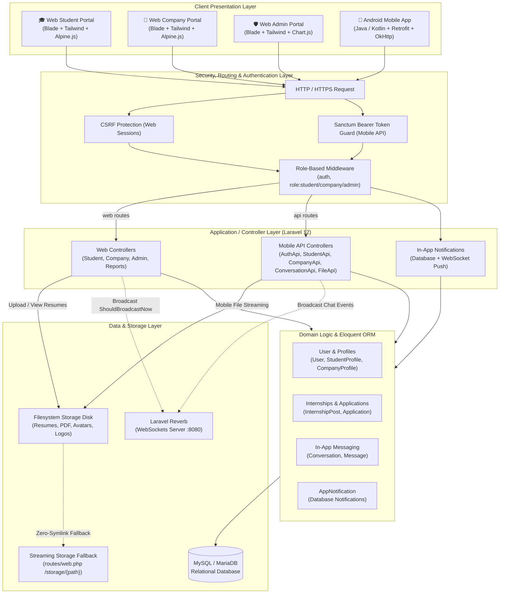
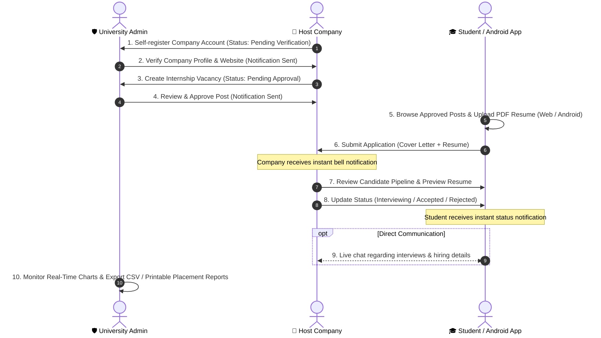

# 🎓 Internship Management System (IMS)

[](https://laravel.com)
[](https://www.php.net)
[](https://laravel.com/docs/sanctum)
[](https://developer.android.com)
[](https://laravel.com/docs/reverb)
[](https://tailwindcss.com)
[](https://alpinejs.dev)
[](https://vitejs.dev)
[](https://www.mysql.com)
[-success?style=for-the-badge&logo=checkmarx&logoColor=white)](https://github.com/thonpheara/InternshipMS)
[](https://opensource.org/licenses/MIT)

**Internship Management System (IMS)** is an enterprise-grade full-stack platform and REST API backend built with **Laravel 12**, **Laravel Sanctum**, **Laravel Reverb WebSockets**, **Tailwind CSS**, **Alpine.js**, **Chart.js**, and **Vite**. It provides a unified ecosystem bridging university students, host employers, and university administrators to streamline internship discovery, candidate applications, corporate verification, job vacancy moderation, real-time bidirectional messaging, instant in-app alerts, placement reporting, and institutional analytics.

In addition to its responsive web portal, the system exposes a secure **Android Mobile REST API** with Bearer token authentication, enabling native Android applications (Java / Kotlin with Retrofit & OkHttp) to interact with all student, company, chat, and notification services.

🔗 **GitHub Repository:** [https://github.com/thonpheara/InternshipMS.git](https://github.com/thonpheara/InternshipMS.git)

---

## 📋 Table of Contents
- [✨ Key Features & Role Portals](#-key-features--role-portals)
  - [🎓 Student Portal](#-student-portal)
  - [🏢 Host Company Portal](#-host-company-portal)
  - [🛡️ University Administrator Portal](#-university-administrator-portal)
  - [🔔 Universal In-App Notification System](#-universal-in-app-notification-system)
- [📱 Android Mobile REST API Suite](#-android-mobile-rest-api-suite)
  - [Authentication & Token Lifecycle](#authentication--token-lifecycle)
  - [Standardized JSON Response Format](#standardized-json-response-format)
  - [API Endpoints Reference](#api-endpoints-reference)
  - [Sample cURL & Retrofit Requests](#sample-curl--retrofit-requests)
- [🏗️ System Architecture & Workflow](#-system-architecture--workflow)
  - [1. High-Level Architectural Diagram](#1-high-level-architectural-diagram)
  - [2. End-to-End Business Process Sequence](#2-end-to-end-business-process-sequence)
  - [3. Role-Based Access Control (RBAC) Matrix](#3-role-based-access-control-rbac-matrix)
  - [4. Layered Architectural Breakdown](#4-layered-architectural-breakdown)
- [💻 System Requirements](#-system-requirements)
- [🚀 Step-by-Step Installation & Setup](#-step-by-step-installation--setup)
- [🏃 Running the Application Locally](#-running-the-application-locally)
- [📱 Android Emulator & Mobile Network Configuration](#-android-emulator--mobile-network-configuration)
- [🧪 Running Automated Tests](#-running-automated-tests)
- [🔑 Default Login Credentials & Access](#-default-login-credentials--access)
- [📂 Project Directory Structure](#-project-directory-structure)
- [🔄 Updating the Project After Changes](#-updating-the-project-after-changes)
- [🛠️ Useful Commands & Troubleshooting](#️-useful-commands--troubleshooting)
- [📄 License](#-license)

---

## ✨ Key Features & Role Portals

### 🎓 Student Portal
- **Internship Opportunity Discovery:** Browse approved corporate postings with dynamic search filters by job title, category/department, stipend disclosure, and workplace modality (*On-site*, *Hybrid*, *Remote*).
- **Recommended Internships:** Dynamic dashboard recommendations showcasing open postings the student has not yet applied for with impending deadlines.
- **Application Submission:** Apply with a customized cover letter and attached PDF resume.
- **Dedicated Resume Management:** Upload and manage personal PDF resumes with direct browser-native previewing, downloading, and isolated file deletion (`storage/app/public/resumes/{student_id}/`).
- **Application Pipeline Tracking:** Real-time visibility into application progress across all stages (*Applied*, *Under Review*, *Interviewed*, *Accepted*, *Rejected*).
- **⚡ Real-Time Direct Messaging (Laravel Reverb & Echo):** Instant peer-to-peer messaging with recruiters powered by WebSockets. Instant asynchronous sending (zero page reload), auto-scrolling, live message bubble streaming, and real-time conversation list updates.
- **Profile Picture & Avatar Customization:** Upload, preview, and update student profile picture with instant live preview and dynamic initials fallback.
- **Academic Profile Configuration:** Manage university student ID, major, department, cumulative GPA, key technical skills, and biographical details.
- **Account Security & Password Management:** Dedicated "Security & Password" tab to change password securely with current password verification, confirmation checks, and eye toggle visibility.
- **⚡ Instant In-App Alerts & Toasts:** Real-time bell notifications and floating interactive toast popups whenever an employer reviews an application, advances status, or sends a message.

### 🏢 Host Company Portal
- **Corporate Registration & Verification:** Self-service company onboarding with profile submission (industry, location, website, hiring contact person, logo) submitted for administrator verification.
- **Enhanced Executive Dashboard:**
  - **4 Key KPI Metrics:** Active Approved Posts, Total Vacancies, Total Applicants, and Pending Action count.
  - **Interactive Recruitment Pipeline Board:** Proportional progress bars breakdown across *Pending Review*, *Shortlisted*, *Interviewing*, *Accepted / Placed*, and *Not Selected*.
  - **Quick Applicant Review Drawer:** Instant access to the latest 10 applicants with direct links to student resumes and status modification.
- **Internship Vacancy Publishing:** Create and edit job postings detailing descriptions, requirements, stipend disclosure, available positions, and application deadlines (held in a moderation queue for university approval).
- **Applicant Review Pipeline Board:** Multi-stage applicant tracking board to inspect student candidates, read cover letters, view PDF resumes in-browser, and advance statuses (*Applied* ➔ *Under Review* ➔ *Shortlisted* ➔ *Interviewed* ➔ *Accepted* / *Rejected*).
- **⚡ Real-Time Candidate Chat (WebSockets):** Seamless live messaging channel with applicants featuring instant message dispatch, live incoming chat bubbles, and auto-updated unread counts.
- **Company Security & Password Management:** Dedicated "Security & Password" tab for recruiter password changes with authentication validation and visibility toggles.
- **⚡ Instant In-App Alerts:** Real-time WebSocket notifications when students submit applications or when administrators verify corporate accounts and approve job listings.

### 🛡️ University Administrator Portal
- **Executive KPI Dashboard:** Real-time metrics overview displaying Total User Accounts, Active Student Interns, Registered Companies, Approved Listings, and Pending Moderation queues.
- **Dual Analytics Engine (Chart.js & Alpine.js):**
  - **Monthly Application & Placement Trends (Bar Chart):** Interactive monthly bar chart comparing **Total Applications Submitted** vs. **Accepted Placements**, with dynamic toggling between **This Year** and **Last Year** data.
  - **Application Outcomes Breakdown (Donut Chart):** Interactive donut chart showing proportional distribution across application statuses (*Accepted*, *In Review*, *Interviewed*, *Rejected*) with center KPI metric and 2x2 categorical breakdown.
  - **Smart Post Moderation Alert:** Context-aware notification bar linking directly to the approvals queue when pending postings exist.
- **Company Verification Queue:** Centralized moderation interface to verify new employer accounts, review company details and official websites, and either approve or reject with custom feedback.
- **Job Post Moderation Queue:** Review, approve, or reject employer internship postings before they become visible to students.
- **User Management (Full CRUD):** Complete administrative management of Student and Company accounts featuring modal-based creation, editing, active/suspended status toggling, and soft-deletes.
- **Admin Profile & Avatar Customization:** Dedicated `/admin/profile` management allowing administrators to update name, email, avatar image, initials badge, and secure password updates.
- **Topbar User Navigation:** Responsive top navigation header showing user profile avatar, role badge, quick drawer links, and one-click logout.
- **Placement & Outcome Reports:**
  - Comprehensive filtering by Academic Year, Department/Major, Host Company, Placement Status, and Date Range.
  - Real-time summary statistics cards (Total Applicants, Placements, Active Companies, Placement Rate %).
  - One-click **CSV Spreadsheet Export** (`/admin/reports/export-csv`) with formatted data columns.
  - Dedicated **Print-Ready / Formal Academic Audit Report** (`/admin/reports/print`) optimized with `@media print` styling for university records, accreditation audits, and administrative reporting.
- **Single-Screen UI (100vh Layout):** Viewport-optimized layout preventing unnecessary whole-page scrolling and providing clean data tables with internal scroll containers.

### 🔔 Universal Real-Time In-App Notification System
- **WebSocket Push Engine (Laravel Reverb):** Instant notifications broadcasted via private user channels (`App.Models.User.{id}`) using `ShouldBroadcastNow`.
- **Dynamic Bell Counter & Ping Animation:** Live badge counter increments (+1) with glowing ping animation without requiring page reloads.
- **Interactive Floating Toast Alerts:** Sleek floating toast popups on the bottom-right corner of the screen containing title, message snippet, and direct action link.
- **Deep-Linked Redirection:** Clicking any notification marks it as read and automatically navigates the user directly to the relevant resource (e.g. specific application, applicant pipeline, company verification page, or job post).
- **Quick Notification Actions:** Single-click "Mark All as Read", individual notification deletion, and "Clear All Notifications".
- **Cross-Workflow Event Triggers:**
  - *Company Registration* ➔ Admin receives pending verification alert.
  - *Admin Verifies/Rejects Company* ➔ Company receives status outcome alert.
  - *New Job Post Submitted* ➔ Admin receives moderation alert.
  - *Admin Approves/Rejects Job Post* ➔ Company receives posting decision alert.
  - *Student Applies to Internship* ➔ Host Company receives application alert.
  - *Company Updates Candidate Status* ➔ Student receives application status alert.
  - *Direct Message Sent* ➔ Recipient receives instant message notification alert.

---

## 📱 Android Mobile REST API Suite

The system includes a dedicated, production-ready REST API built with **Laravel Sanctum** specifically engineered for mobile client consumption (Android Native with Kotlin / Java, Retrofit 2, OkHttp, or Jetpack Compose).

### Authentication & Token Lifecycle
- Uses **Personal Access Tokens** (`Bearer <token>`).
- Client passes `device_name` upon authentication (e.g. `Android Samsung A54`).
- Secure token revocation upon logout (`$user->tokens()->delete()`).
- Protected by `auth:sanctum` and role-based middleware (`role:student`, `role:company`).

### Standardized JSON Response Format
All API endpoints return a predictable, strongly-typed JSON envelope:

#### Success Response (`200 OK` / `201 Created`):
```json
{
  "success": true,
  "message": "Operation completed successfully.",
  "data": { ... }
}
```

#### Error Response (`400 Bad Request` / `401 Unauthorized` / `422 Unprocessable`):
```json
{
  "success": false,
  "message": "Validation failed.",
  "errors": {
    "email": ["The email has already been taken."]
  }
}
```

### API Endpoints Reference

| HTTP Method | Route Endpoint | Middleware / Auth | Description |
| :--- | :--- | :--- | :--- |
| **`POST`** | `/api/auth/login` | Public | Authenticate student or company & issue Sanctum Bearer token |
| **`POST`** | `/api/auth/register` | Public | Self-service registration for students or companies |
| **`GET`** | `/api/auth/me` | `auth:sanctum` | Retrieve authenticated user profile, role, avatar, and metadata |
| **`POST`** | `/api/auth/logout` | `auth:sanctum` | Invalidate and revoke current access token |
| **`PUT`** | `/api/auth/password` | `auth:sanctum` | Change user password with current password verification |
| **`POST`** | `/api/auth/avatar` | `auth:sanctum` | Upload and set profile avatar image |
| **`DELETE`**| `/api/auth/avatar` | `auth:sanctum` | Remove user profile avatar image |
| **`GET`** | `/api/student/dashboard` | `role:student` | Student KPI statistics, active applications, & recommendations |
| **`GET`** | `/api/student/profile` | `role:student` | Get student academic details (major, GPA, skills, resume) |
| **`POST`** | `/api/student/profile` | `role:student` | Update student profile information |
| **`POST`** | `/api/student/resume` | `role:student` | Upload student PDF resume file |
| **`DELETE`**| `/api/student/resume` | `role:student` | Delete current student PDF resume |
| **`GET`** | `/api/student/posts` | `role:student` | Search approved jobs (query, category, modality, stipend) |
| **`GET`** | `/api/student/posts/{id}`| `role:student` | Inspect individual internship post details & company profile |
| **`POST`** | `/api/student/posts/{id}/apply` | `role:student` | Apply to internship vacancy with cover letter & resume |
| **`GET`** | `/api/student/applications` | `role:student` | List all submitted student applications and review stages |
| **`GET`** | `/api/student/applications/{id}` | `role:student` | Detailed application status tracker |
| **`GET`** | `/api/company/dashboard` | `role:company` | Employer dashboard stats, vacancy counts, and pipeline summary |
| **`GET`** | `/api/company/profile` | `role:company` | Get host employer corporate profile details |
| **`POST`** | `/api/company/profile` | `role:company` | Update company description, website, contact, and logo |
| **`GET`** | `/api/company/posts` | `role:company` | List company vacancies across all moderation states |
| **`POST`** | `/api/company/posts` | `role:company` | Create a new internship listing (enters moderation queue) |
| **`GET`** | `/api/company/posts/{id}` | `role:company` | Inspect vacancy details |
| **`PUT`** | `/api/company/posts/{id}` | `role:company` | Update existing internship listing |
| **`DELETE`**| `/api/company/posts/{id}` | `role:company` | Delete internship listing |
| **`GET`** | `/api/company/applicants` | `role:company` | List candidates applying to company vacancies |
| **`GET`** | `/api/company/applicants/{id}` | `role:company` | Detailed candidate review (cover letter, academic profile) |
| **`PUT`** | `/api/company/applicants/{id}/status` | `role:company` | Advance candidate status (*under_review*, *shortlisted*, *accepted*, etc.) |
| **`GET`** | `/api/conversations` | `auth:sanctum` | List all active direct messaging conversations |
| **`GET`** | `/api/conversations/{id}` | `auth:sanctum` | Fetch message history within a conversation |
| **`POST`** | `/api/conversations/{id}/messages` | `auth:sanctum` | Send an instant message within a conversation |
| **`POST`** | `/api/conversations/start/{applicationId}` | `auth:sanctum` | Initiate direct chat linked to an active job application |
| **`GET`** | `/api/notifications` | `auth:sanctum` | Paginated in-app notification list |
| **`GET`** | `/api/notifications/unread-count` | `auth:sanctum` | Get raw unread notification count badge integer |
| **`POST`** | `/api/notifications/{id}/read` | `auth:sanctum` | Mark individual notification as read |
| **`POST`** | `/api/notifications/read-all` | `auth:sanctum` | Mark all user notifications as read |
| **`DELETE`**| `/api/notifications/{id}` | `auth:sanctum` | Delete a single notification record |
| **`DELETE`**| `/api/notifications` | `auth:sanctum` | Clear all user notification records |
| **`GET`** | `/api/files/applications/{id}/resume` | `auth:sanctum` | Secure stream / download candidate application resume |
| **`GET`** | `/api/files/students/{id?}/resume` | `auth:sanctum` | Secure stream / download student profile resume |

### Sample cURL & Retrofit Requests

#### 1. Mobile Authentication (Login)
```bash
curl -X POST http://127.0.0.1:8000/api/auth/login \
  -H "Content-Type: application/json" \
  -H "Accept: application/json" \
  -d '{
    "email": "student@usea.edu.kh",
    "password": "password123",
    "device_name": "Pixel 8 Pro Android"
  }'
```

#### 2. Authenticated Request (Fetching Student Dashboard)
```bash
curl -X GET http://127.0.0.1:8000/api/student/dashboard \
  -H "Accept: application/json" \
  -H "Authorization: Bearer 1|AbCdEf123456..."
```

---

## 🏗️ System Architecture & Workflow

Internship Management System implements a multi-tier **Model-View-Controller (MVC)** architectural pattern built on the Laravel 12 framework. The architecture enforces strict separation of concerns across presentation (Web Blade + Android Mobile), routing & middleware, application controllers, domain models, notifications, and relational persistence.

For detailed technical specifications, refer to [docs/SYSTEM_ARCHITECTURE.md](docs/SYSTEM_ARCHITECTURE.md).

### 1. High-Level Architectural Diagram



### 2. End-to-End Business Process Sequence



### 3. Role-Based Access Control (RBAC) Matrix

| Feature / Resource | Guest | 🎓 Student | 🏢 Company | 🛡️ Admin |
| :--- | :---: | :---: | :---: | :---: |
| **Browse Landing Page & Login** | ✅ | ✅ | ✅ | ✅ |
| **Self-Service Registration (Web & API)** | ✅ | ✅ | ✅ | ❌ |
| **Mobile Android REST API Endpoints** | ✅ *(auth)* | ✅ | ✅ | ❌ |
| **In-App Notification Bell & Drawer** | ❌ | ✅ | ✅ | ✅ |
| **Student Profile & PDF Resume Management** | ❌ | ✅ | ❌ | ❌ |
| **Profile Password Management & Security** | ❌ | ✅ | ✅ | ✅ |
| **Profile Avatar Upload & Customization** | ❌ | ✅ | ✅ | ✅ |
| **Browse Approved Jobs & Submit Applications** | ❌ | ✅ | ❌ | ❌ |
| **Direct Messaging (Active Applications)** | ❌ | ✅ | ✅ | ❌ |
| **Company Profile & Corporate Logo Management** | ❌ | ❌ | ✅ | ❌ |
| **Post Vacancies (Subject to Moderation)** | ❌ | ❌ | ✅ | ❌ |
| **Applicant Pipeline & In-Browser Resume Preview** | ❌ | ❌ | ✅ | ❌ |
| **Candidate Status Update (Accept/Reject)** | ❌ | ❌ | ✅ | ❌ |
| **Company Verification Queue (Approve/Reject)** | ❌ | ❌ | ❌ | ✅ |
| **Job Post Moderation Queue (Approve/Reject)** | ❌ | ❌ | ❌ | ✅ |
| **User Management (CRUD Students & Employers)** | ❌ | ❌ | ❌ | ✅ |
| **Dual Analytics (Bar Trends + Outcomes Donut)** | ❌ | ❌ | ❌ | ✅ |
| **Placement & Outcome Reports (CSV & Print)** | ❌ | ❌ | ❌ | ✅ |

### 4. Layered Architectural Breakdown

| Layer | Technologies & Components | Primary Responsibility |
| :--- | :--- | :--- |
| **Presentation Tier** | Blade, Tailwind CSS, Alpine.js, Chart.js, FontAwesome 6, Vite | Responsive UI, interactive modal dialogs, PDF preview drawer, dynamic charts, and notification badge. |
| **Mobile API Tier** | Laravel Sanctum, JsonResponse, BaseApiController | Mobile authentication, token issuing, standardized JSON envelope, and error validation formatting. |
| **Real-Time WebSockets** | Laravel Reverb, Laravel Echo, Pusher-js, Private Channels | Instant peer-to-peer messaging, live chat bubbles, real-time unread badges, and instant notification toasts. |
| **Routing & Middleware** | Laravel Web Router (`routes/web.php`), API Router (`routes/api.php`), Channels (`routes/channels.php`) | Request routing, channel authentication, session state validation, CSRF verification, and strict role guards (`role:student`, `role:company`, `role:admin`). |
| **Application Tier** | PHP 8.2+, Laravel 12 Controllers & Broadcast Events | Request validation, business logic, notification dispatching, WebSocket event broadcasting (`MessageSent`), file uploads, CSV generation, and view rendering. |
| **Domain & Data Tier** | Eloquent ORM Models (`User`, `StudentProfile`, `CompanyProfile`, `InternshipPost`, `Application`, `Conversation`, `Message`) | Relationships, cascading constraints, soft deletes, timestamps, and database notifications. |
| **Storage & Persistence** | MySQL 8.x / MariaDB, Filesystem (`storage/app/public`) | Relational transaction integrity, isolated student resume storage, and public streaming fallback route. |

---

## 💻 System Requirements

Before running the application locally, ensure your environment meets the following specifications:

- **PHP:** `>= 8.2` (Extensions required: `pdo_mysql`, `fileinfo`, `mbstring`, `openssl`, `curl`)
- **Composer:** PHP Dependency Manager (v2.x)
- **Node.js:** `>= 18.x` & **npm**
- **Database:** MySQL `>= 8.0` or MariaDB `>= 10.4` (via XAMPP, Laragon, WampServer, or native service)
- **Git:** Version Control System
- **Android Studio (Optional for Mobile Development):** Ladybug / Koala / Hedgehog with Android SDK `>= 26` (Android 8.0 Oreo+)

---

## 🚀 Step-by-Step Installation & Setup

### Step 1: Clone the Repository
```bash
git clone https://github.com/thonpheara/InternshipMS.git
cd InternshipMS
```

---

### Step 2: Install PHP & Node.js Dependencies

1. **Install PHP Dependencies (Composer):**
   ```bash
   composer install
   ```

2. **Install Node.js Dependencies (npm):**
   ```bash
   npm install
   ```

---

### Step 3: Configure Environment (`.env`)

1. **Copy the example environment file:**
   - **Windows (PowerShell):**
     ```powershell
     Copy-Item .env.example .env
     ```
   - **Windows (Command Prompt):**
     ```cmd
     copy .env.example .env
     ```
   - **Linux / macOS:**
     ```bash
     cp .env.example .env
     ```

2. **Generate the Laravel Application Key:**
   ```bash
   php artisan key:generate
   ```

3. **Generate Real-Time WebSockets (Reverb) Keys:**
   ```bash
   php artisan reverb:install
   ```
   *This automatically creates unique `REVERB_APP_ID`, `REVERB_APP_KEY`, and `REVERB_APP_SECRET` and writes them into your `.env` file.*

---

### Step 4: Configure the Database

1. **Start your MySQL server** (e.g., via XAMPP or Laragon control panel).
2. **Create the Database:** Create a database named `intern_db` in phpMyAdmin (`http://localhost/phpmyadmin`) or via the MySQL CLI:
   ```sql
   CREATE DATABASE intern_db CHARACTER SET utf8mb4 COLLATE utf8mb4_unicode_ci;
   ```
3. **Verify Database & WebSockets parameters in `.env`:**
   ```env
   APP_NAME="Internship Management System"
   APP_ENV=local
   APP_KEY=base64:...
   APP_DEBUG=true
   APP_URL=http://127.0.0.1:8000

   DB_CONNECTION=mysql
   DB_HOST=127.0.0.1
   DB_PORT=3306
   DB_DATABASE=intern_db
   DB_USERNAME=root
   DB_PASSWORD=

   # Real-Time WebSockets (Laravel Reverb)
   BROADCAST_CONNECTION=reverb
   REVERB_APP_ID=your-reverb-app-id
   REVERB_APP_KEY=your-reverb-app-key
   REVERB_APP_SECRET=your-reverb-app-secret
   REVERB_HOST="localhost"
   REVERB_PORT=8080
   REVERB_SCHEME=http

   VITE_REVERB_APP_KEY="${REVERB_APP_KEY}"
   VITE_REVERB_HOST="${REVERB_HOST}"
   VITE_REVERB_PORT="${REVERB_PORT}"
   VITE_REVERB_SCHEME="${REVERB_SCHEME}"
   ```

---

### Step 5: Run Database Migrations & Seeders

Execute schema migrations (including users, profiles, posts, applications, messaging, personal access tokens, and database notifications) and seed the initial administrator account:
```bash
php artisan migrate --seed
```

> [!TIP]
> **Need a clean slate?** To completely reset your database and reseed at any time:
> ```bash
> php artisan migrate:fresh --seed
> ```

---

### Step 6: Create Storage Symbolic Link

To ensure uploaded resumes, company logos, and student avatars are publicly accessible:
```bash
php artisan storage:link
```

> [!NOTE]
> Even if OS-level symbolic links are restricted (e.g. Windows non-admin terminals), the built-in streaming fallback route (`/storage/{path}`) in `routes/web.php` automatically handles file serving and PDF downloads seamlessly!

---

## 🏃 Running the Application Locally

### Option A: Single Command Launch (Recommended)
You can start all required development services simultaneously with a single command:

```bash
composer run dev
```

*This automatically launches all 4 processes concurrently (customized for Windows without `pcntl` issues):*
- 🌐 **`server`**: Laravel Backend Server (`http://127.0.0.1:8000`)
- ⚡ **`queue`**: Background Job Listener (`queue:listen`)
- 🎨 **`vite`**: Vite Frontend Hot-Module Replacement
- 📡 **`reverb`**: Real-Time WebSocket Server (`ws://localhost:8080`)

---

### Option B: Running in Separate Terminals

If you prefer managing processes in separate terminal windows:

1. **Terminal 1 — Laravel Web & API Server:**
   ```bash
   php artisan serve
   ```
   *Application & API will be available at:* `http://127.0.0.1:8000`

2. **Terminal 2 — Vite Hot-Reload:**
   ```bash
   npm run dev
   ```

3. **Terminal 3 — Reverb WebSocket Server:**
   ```bash
   php artisan reverb:start --debug
   ```

4. **Terminal 4 — Queue Worker (Optional):**
   ```bash
   php artisan queue:listen
   ```

---

## 📱 Android Emulator & Mobile Network Configuration

When connecting an Android application to the local Laravel backend:

### 1. Android Virtual Device (AVD / Emulator)
Android emulators run on a separate internal virtual network. To access your host machine's `localhost`:
- **Base URL:** `http://10.0.2.2:8000/api/`
- Ensure `android:usesCleartextTraffic="true"` is enabled in your Android app's `AndroidManifest.xml` (for non-HTTPS local development).

### 2. Physical Android Device (Over Wi-Fi)
To test on a physical Android smartphone connected to the same Wi-Fi network:
1. Start Laravel binding to all network interfaces:
   ```bash
   php artisan serve --host=0.0.0.0 --port=8000
   ```
2. Find your PC's local IP address (`ipconfig` on Windows or `ifconfig` on macOS/Linux, e.g. `192.168.1.150`).
3. Set your Android Retrofit base URL: `http://192.168.1.150:8000/api/`

---

## 🧪 Running Automated Tests

The application includes a comprehensive automated test suite built on **PHPUnit** covering Authentication, In-App Notifications, Resume Upload/Preview, Administrator Features, Company Verification, Placement Reports, User Management CRUD, Profile Avatars, and the Android Mobile REST API:

```bash
php artisan test
```

### Test Suite Summary:
- **`AndroidApiTest` (8 tests):** Sanctum token authentication, invalid credential rejection, student registration via API, Bearer token authorization guards, student dashboard & posts browsing, job application submission, role authorization enforcement (`role:company` vs `role:student`), conversation chat dispatch, and in-app notifications.
- **`UserProfileAvatarTest` (6 tests):** User model avatar and initials accessors, company profile logo accessors, admin profile view & avatar upload, password changes, route security guards, and topbar user info rendering.
- **`RealtimeBroadcastingTest` (4 tests):** Real-time WebSockets event broadcasting (`MessageSent`), instant AJAX transmission for Student & Company messaging, `AppNotification` broadcast verification (`ShouldBroadcastNow`), and channel participant authorization security.
- **`AdminFeaturesTest` (7 tests):** Company verification queue, verification approvals, rejection with notes, placement report filters, CSV export, and print preview.
- **`NotificationTest` (7 tests):** Notification delivery, unread counter badges, mark as read with redirect, mark all as read, delete single notification, clear all, and peer message notification triggers.
- **`PostStatusSecurityTest` (4 tests):** Strict job post status authorization (companies cannot self-approve pending posts or manipulate post states).
- **`ResumeManagementTest` (4 tests):** Student profile PDF resume upload, browser preview, file deletion, and employer applicant resume preview.
- **`UserManagementTest` (8 tests):** Admin user index, Chart.js analytics dashboard metrics, student creation, company creation, user updates, soft-deletes, and RBAC guard tests.
- **`ExampleTest` (1 test):** Application baseline and unit integrity.

**Result:** `49 passed (210 assertions)`

---

## 🔑 Default Login Credentials & Access

### 1. System Administrator (Pre-Seeded)
- **Login URL:** `http://127.0.0.1:8000/login`
- **Email:** `admin@gmail.com`
- **Password:** `1234567890`
- **Role:** Full University Administrator Privileges

### 2. Student & Host Company Self-Registration
- **Registration URL:** `http://127.0.0.1:8000/register` (or via API: `POST /api/auth/register`)
- Students and Host Companies can self-register directly through the portal:
  - **Students:** Register and immediately access the student dashboard, browse internships, customize profiles, and upload resumes.
  - **Companies:** Register corporate accounts. The profile enters the **Admin Company Verification Queue** where administrators can verify their business details.

---

## 📂 Project Directory Structure

```plaintext
InternshipMS/
├── app/
│   ├── Events/
│   │   └── MessageSent.php                            # Real-time WebSocket broadcast event (ShouldBroadcastNow)
│   ├── Http/
│   │   ├── Controllers/
│   │   │   ├── Admin/
│   │   │   │   ├── AdminDashboardController.php       # Dashboard metrics & Chart.js data
│   │   │   │   ├── AdminProfileController.php         # Admin avatar & password management
│   │   │   │   ├── CompanyVerificationController.php  # Company approval/rejection queue
│   │   │   │   ├── PostApprovalController.php         # Job post moderation queue
│   │   │   │   ├── ReportController.php               # Placement reports, CSV export, Print view
│   │   │   │   └── UserManagementController.php       # Full student & company CRUD
│   │   │   ├── Api/
│   │   │   │   ├── AuthApiController.php              # Sanctum login, register, me, password, avatar
│   │   │   │   ├── BaseApiController.php              # Standardized JSON response envelope
│   │   │   │   ├── CompanyApiController.php           # Mobile company dashboard, vacancies, applicants
│   │   │   │   ├── ConversationApiController.php      # Mobile direct messaging & chat
│   │   │   │   ├── FileApiController.php              # Secure mobile resume streaming & download
│   │   │   │   ├── NotificationApiController.php      # Mobile notification list, count, mark-read
│   │   │   │   └── StudentApiController.php           # Mobile student dashboard, resume, jobs, apply
│   │   │   ├── Company/
│   │   │   │   ├── ApplicantReviewController.php      # Pipeline board & status updates
│   │   │   │   ├── CompanyDashboardController.php     # Company KPI stats & pipeline breakdown
│   │   │   │   ├── CompanyProfileController.php       # Corporate profile & logo
│   │   │   │   ├── InternshipPostController.php       # Job posting CRUD
│   │   │   │   └── MessageController.php              # Real-time direct candidate messaging
│   │   │   ├── Student/
│   │   │   │   ├── InternshipBrowseController.php     # Job search, filters, apply
│   │   │   │   ├── MessageController.php              # Real-time direct company messaging
│   │   │   │   └── StudentDashboardController.php     # Profile, recommendations & resume management
│   │   │   ├── AuthController.php                     # Authentication & registration (Web)
│   │   │   └── NotificationController.php             # In-app notifications handler (Web)
│   │   └── Middleware/
│   │       └── RoleMiddleware.php                     # Role-based route guard
│   ├── Models/
│   │   ├── Application.php                            # Student job applications
│   │   ├── CompanyProfile.php                         # Company details & verification
│   │   ├── Conversation.php                           # Direct messaging threads & participant guards
│   │   ├── InternshipPost.php                         # Job vacancies
│   │   ├── Message.php                                # Chat messages
│   │   ├── StudentProfile.php                         # Student details & resume paths
│   │   └── User.php                                   # Base user accounts, avatars, initials & roles
│   └── Notifications/
│       └── AppNotification.php                        # Real-time broadcastable database notification class
├── config/
│   ├── broadcasting.php                               # Broadcast connections (Reverb, Pusher, etc.)
│   ├── reverb.php                                     # Laravel Reverb server configuration
│   └── sanctum.php                                    # Laravel Sanctum token configuration
├── database/
│   ├── migrations/                                    # Database schema migrations (users, tokens, etc.)
│   └── seeders/
│       ├── DatabaseSeeder.php                         # Primary seeder runner
│       └── UserSeeder.php                             # Admin account seeder
├── docs/
│   └── SYSTEM_ARCHITECTURE.md                         # Detailed technical architecture spec
├── resources/
│   ├── css/
│   │   └── app.css                                    # Tailwind CSS setup
│   ├── js/
│   │   ├── app.js                                     # Core scripts bundle
│   │   ├── bootstrap.js                               # Axios & Echo bootstrapper
│   │   └── echo.js                                    # Laravel Echo & Pusher-js client configuration
│   └── views/
│       ├── Admin/                                     # Admin views (dashboard, profile, reports, verification, users)
│       ├── company/                                   # Company views (pipeline, dashboard, posts, profile, chat)
│       ├── student/                                   # Student views (browse, apply, profile, resumes, chat)
│       ├── components/                                # Shared Blade components (topbar, sidebar, layout)
│       └── auth/                                      # Login & Registration views
├── routes/
│   ├── api.php                                        # Mobile Android REST API routes (Sanctum)
│   ├── channels.php                                   # WebSocket private channel authorization rules
│   └── web.php                                        # Web routes & storage streaming fallback
└── tests/
    └── Feature/                                       # 49 automated feature tests (210 assertions)
```

---

## 🔄 Updating the Project After Changes

Whenever pulling updates or switching branches:

```bash
# 1. Pull latest commits from GitHub
git pull origin main

# 2. Run new migrations
php artisan migrate

# 3. Clear application caches
php artisan optimize:clear

# 4. Compile frontend assets
npm run build      # (or 'npm run dev' for development)
```

---

## 🛠️ Useful Commands & Troubleshooting

| Task / Problem | Command / Solution |
| :--- | :--- |
| **Run Automated Tests** | `php artisan test` *(49 tests, 210 assertions)* |
| **Clear All Application Caches** | `php artisan optimize:clear` |
| **Recompile Assets for Production** | `npm run build` |
| **Fix Broken Resumes or Logos** | `php artisan storage:link` *(Also supported via `/storage/{path}` route)* |
| **Reset Database with Fresh Seed** | `php artisan migrate:fresh --seed` |
| **List All Registered Routes (Web & API)** | `php artisan route:list` |
| **Inspect API Routes Exclusively** | `php artisan route:list --path=api` |
| **Database Connection Refused** | Ensure MySQL service is running in XAMPP/Laragon and credentials match `.env`. |
| **Vite Manifest Not Found** | Run `npm install && npm run build` (or start `npm run dev`). |
| **Android Network Security Config Error** | Set `android:usesCleartextTraffic="true"` in Android Manifest for HTTP endpoints. |

---

## 📄 License

This project is open-source software licensed under the [MIT License](https://opensource.org/licenses/MIT).